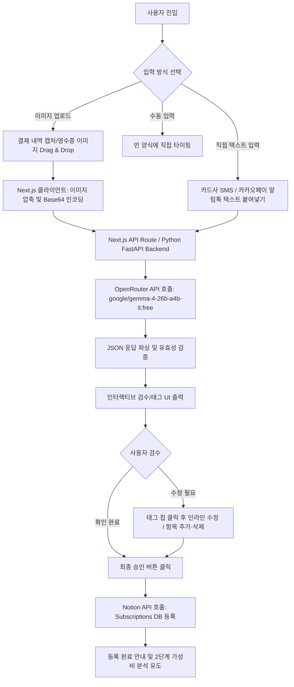

# [PRD 1단계] 구독 서비스 및 고정지출 데이터 입력·인식 (Data Ingestion & Vision OCR)

---

## 1. 개요 (Overview & Objective)

### 1.1 프로젝트 배경 및 목적
- **배경:** 대학생 및 사회초년생은 OTT(넷플릭스, 티빙), 음원(스포티파이, 유튜브 프리미엄), 클라우드/생산성 도구(Notion, ChatGPT), 통신비 등 다수의 구독 및 고정 지출을 보유하고 있으나, 카드 승인 문자, 간편결제 영수증, 앱스토어 인앱 결제 등에 분산되어 있어 총 지출 규모와 결제 주기를 한눈에 파악하기 어렵다.
- **1단계 핵심 목표:** 
  - 사용자가 결제 문자/영수증 캡처 이미지를 업로드하거나 결제 알림 텍스트를 붙여넣었을 때, **OpenRouter API의 `google/gemma-4-26b-a4b-it:free` (Vision 멀티모달 모델)**을 통해 비정형 데이터를 고순도의 정형 JSON 데이터로 실시간 자동 추출한다.
  - 추출된 데이터를 검수·수정할 수 있는 인터랙티브 UI를 제공하고, 승인된 데이터를 **팀 노션 [Subscriptions] 데이터베이스**에 즉시 동기화(CRUD)한다.

### 1.2 핵심 성공 지표 (KPI)
- OCR 영수증/결제 캡처 인식 정확도(서비스명/금액/결제일 기준): **90% 이상**
- 비정형 텍스트/이미지 파싱 응답 속도: **평균 4초 이내**
- 사용자 파싱 결과 수정률(오인식 보정 빈도): **20% 이하**

---

## 2. 유저 플로우 (User Flow)



---

## 3. 기능적 요구사항 (Functional Requirements & API Specs)

### 3.1 결제 내역 캡처 이미지 및 텍스트 수집 (Frontend)
1. **이미지 업로드 컴포넌트:**
   - 지원 포맷: `image/png`, `image/jpeg`, `image/webp`, `image/heic` (최대 파일 크기: 10MB)
   - 모바일 최적화: 카메라 촬영 및 앨범 선택 지원 (`capture="environment"`)
   - 다중 파일 업로드: 최대 5장까지 일괄 파싱 지원
   - 클라이언트 사이드 전처리: `browser-image-compression` 라이브러리를 통해 긴 축 기준 1920px 이하, 용량 1MB 미만으로 자동 압축 후 Base64 인코딩 전송.
2. **텍스트 일괄 붙여넣기 컴포넌트:**
   - 토스, 카카오뱅크, 신한/국민카드 등의 SMS/알림톡 승인 문자를 여러 개 복사해 한 번에 붙여넣을 수 있는 멀티라인 Textarea 제공.
   - 정규식(Regex) 기반 1차 필터링: 결제 금액 패턴(`[0-9,]+원`, `₩[0-9,]+`, `\$[0-9.]+`) 사전 감지.

---

### 3.2 OpenRouter API 멀티모달 파싱 엔진 연동
- **엔드포인트:** `POST https://openrouter.ai/api/v1/chat/completions`
- **사용 모델:** `google/gemma-4-26b-a4b-it:free`
- **Fallback 모델:** `google/gemini-2.0-flash-exp:free` (할당량 소진 시 대체)
- **헤더 규격:**
  ```http
  Authorization: Bearer ${OPENROUTER_API_KEY}
  HTTP-Referer: ${NEXT_PUBLIC_APP_URL}
  X-Title: Campus-Sub-Rebalancer
  Content-Type: application/json
  ```

#### [Vision System & User Prompt 설계]
```markdown
[System Role]
너는 대한민국 대학생 및 20대 사용자의 금융 결제 영수증 및 승인 문자를 전문적으로 분석하는 '스마트 핀테크 OCR 파서'이다. 
주어진 이미지 또는 텍스트에서 정기 구독 및 고정 지출 항목을 식별하고, 엄격한 JSON 스키마 규격으로만 응답해야 한다.

[추출 규칙]
1. service_name: 서비스 공식 명칭을 한글 또는 영어로 통일 (예: "넷플릭스", "유튜브 프리미엄", "쿠팡 로켓와우", "ChatGPT Plus")
2. category: [OTT, 음원, 생산성/AI, 쇼핑/멤버십, 통신/클라우드, 생활/주거, 기타] 중 택 1
3. amount: 결제된 순수 원화(KRW) 금액을 정수형 숫자로 추출. 외화($) 결제 시 원화 환산이 적혀있으면 원화 우선, 외화만 있을 경우 원본 통화와 금액 표기.
4. billing_cycle: [월간, 연간, 주간, 1회성] 중 판별 (정기 결제 패턴이 보이면 "월간" 기본)
5. billing_date: 결제일(승인일)의 일자(1~31) 숫자 추출.
6. confidence_score: 0.0 ~ 1.0 사이의 파싱 신뢰도 점수.

[주의사항]
- 마크다운 블록(```json ... ```)을 포함하지 말고 순수 JSON 문자열만 반환할 것.
- 카드번호, 승인번호, 사용자 실명 등 민감한 금융 개인정보는 절대 추출하지 말 것.
- 하나의 영수증/이미지에 여러 결제 건이 포함된 경우 배열(items)로 모두 추출할 것.
```

#### [Request Payload 구조 (Image Base64)]
```json
{
  "model": "google/gemma-4-26b-a4b-it:free",
  "messages": [
    {
      "role": "user",
      "content": [
        {
          "type": "text",
          "text": "첨부된 결제 영수증/문자 캡처 이미지에서 구독 및 고정 지출 목록을 JSON 형식으로 추출해줘."
        },
        {
          "type": "image_url",
          "image_url": {
            "url": "data:image/jpeg;base64,/9j/4AAQSkZJRgABAQ..."
          }
        }
      ]
    }
  ],
  "temperature": 0.1,
  "max_tokens": 1500
}
```

---

### 3.3 정형 데이터 JSON Schema & Notion DB 연동 규격

#### [파싱 출력 표준 JSON 스키마]
```json
{
  "status": "success",
  "items": [
    {
      "id": "sub_temp_01",
      "service_name": "유튜브 프리미엄",
      "category": "음원",
      "amount": 14900,
      "currency": "KRW",
      "billing_cycle": "월간",
      "billing_date": 15,
      "payment_method": "신한카드(체크)",
      "is_active": true,
      "confidence_score": 0.95
    },
    {
      "id": "sub_temp_02",
      "service_name": "쿠팡 와우 멤버십",
      "category": "쇼핑/멤버십",
      "amount": 7890,
      "currency": "KRW",
      "billing_cycle": "월간",
      "billing_date": 28,
      "payment_method": "카카오페이머니",
      "is_active": true,
      "confidence_score": 0.91
    }
  ]
}
```

#### [Notion API: Subscriptions 데이터베이스 프로퍼티 매핑]
- **Notion Database Name:** `Subscriptions` (팀 공유 노션 페이지)
- **API Version:** `2022-06-28`

| Notion Property | Notion Type | JSON Source Key | 비고 |
| :--- | :--- | :--- | :--- |
| **Service Name** | `title` | `service_name` | 구독 서비스명 (Title) |
| **Category** | `select` | `category` | OTT, 음원, 생산성/AI, 쇼핑/멤버십, 통신, 기타 |
| **Monthly Cost** | `number` | `amount` | 원화 금액 (Format: `number_with_commas`) |
| **Billing Cycle** | `select` | `billing_cycle` | 월간, 연간, 주간 |
| **Billing Day** | `number` | `billing_date` | 1~31 정수값 (매월 결제일) |
| **Payment Method**| `rich_text` | `payment_method`| 결제 수단 (예: 현대카드, 네이버페이) |
| **Status** | `status` | `is_active` ? "Active" : "Paused" | 구독 유지 상태 |
| **Created At** | `date` | `ISO8601 String` | 파싱 및 등록 시각 |
| **Profile Rel** | `relation` | `profile_page_id` | 3단계 대학생 Profile DB와 연결 |

---

## 4. UI/UX 디자인 스펙

### 4.1 레이아웃 구조
1. **상단 네비게이션:** 단계 표시 인디케이터 (`[1] 데이터 입력/인식` → `[2] AI 리밸런싱` → `[3] 프로필 & 대시보드`)
2. **입력 존 (Hero Dropzone):**
   - 탭 전환: `[이미지/캡처 업로드]` vs `[승인문자 붙여넣기]` vs `[직접 추가]`
   - Drag & Drop 드롭존: 점선 테두리(`border-dashed border-sky-400`), 업로드 시 로딩 스피너 및 프로그레스 바(AI 분석 중...) 출력.
3. **인터랙티브 검수 태그 카드 덱 (Interactive Review Section):**
   - AI가 추출한 각 구독 건을 독립적인 카드(Card) 및 태그 칩(Tag Chip)으로 시각화.
   - **인라인 수정:** 서비스명, 금액, 결제일을 클릭하면 즉시 Input field로 전환되어 키보드로 수정 가능.
   - **신뢰도 경고 배지:** `confidence_score < 0.8`인 경우 노란색 경고 뱃지(`⚠️ 확인 필요`) 표시.
   - **카테고리 셀렉터:** 원클릭 컬러 뱃지 (OTT는 보라, 음원은 녹색, 쇼핑은 주황 등).
   - **항목 추가 및 삭제:** 누락된 항목을 위한 `+ 직접 추가` 버튼 및 카드 우측 상단 `✕` 삭제 버튼.
4. **하단 액션 바:**
   - 선택된 총 고정 지출 합계 실시간 반영 (`총 4건 | 매월 48,290원 지출 중`)
   - `노션에 저장하고 2단계 가성비 분석하기 →` (Primary Button)

---

## 5. 예외 처리 및 에러 핸들링 (Exception Handling)

| 상황 (Scenario) | 에러 코드 / 상태 | 처리 정책 (Fallback & UX) |
| :--- | :--- | :--- |
| **흐릿한 이미지 / 글자 식별 불가** | `ERR_VISION_LOW_CONFIDENCE` | "텍스트를 식별하기 어렵습니다. 밝은 곳에서 다시 촬영하거나 직접 텍스트로 붙여넣어 주세요." 토스트 팝업 후 수동 입력 모드 오픈. |
| **OpenRouter 무료 모델 Rate Limit** (429 Too Many Requests) | `ERR_OPENROUTER_429` | 1차: Exponential Backoff (1초, 2초, 4초 대기 후 재시도).<br>2차: 백업 무료 모델(`google/gemini-2.0-flash-exp:free`)로 즉시 Fallback 전환. |
| **JSON 스키마 파싱 실패 (Malformed Output)** | `ERR_JSON_PARSE` | 정규식으로 JSON 블록(`\{[\s\S]*\}`) 추출 재시도. 실패 시 원본 텍스트를 보여주고 사용자가 폼에 직접 입력하도록 유도. |
| **민감 개인정보 감지** | `WARN_PII_DETECTED` | 이미지 및 텍스트에서 주민등록번호, 카드 번호 16자리 감지 시 클라이언트 단에서 마스킹(`****-****-****-1234`) 처리 후 백엔드로 전송. |
| **Notion API 토큰 만료/권한 없음** | `ERR_NOTION_AUTH_401` | "노션 워크스페이스 연결이 만료되었습니다. 설정에서 노션 연동을 다시 확인해 주세요." 알림 및 로컬스토리지 임시 저장. |

---

## 6. 개발 체크리스트 (Definition of Done)
- [ ] Next.js 기반 Dropzone 및 카메라 연동 클라이언트 컴포넌트 구현
- [ ] 클라이언트 이미지 압축 모듈(`browser-image-compression`) 연동
- [ ] OpenRouter API `google/gemma-4-26b-a4b-it:free` 멀티모달 프롬프트 테스트 완료
- [ ] JSON 응답 유효성 검증(Zod Schema) 파이프라인 작성
- [ ] 인터랙티브 인라인 편집 및 카테고리 태그 UI 구현
- [ ] Notion API client SDK를 통한 [Subscriptions] 데이터베이스 레코드 삽입 테스트 통과
