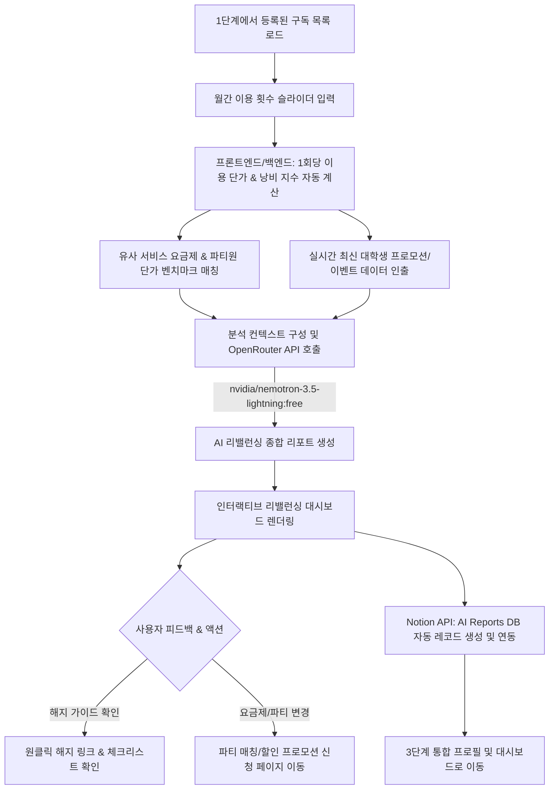

# [PRD 2단계] 가성비 분석, 타사 요금제 비교 및 AI 리밸런싱 리포트 생성 (Analytics & AI Rebalancing)

---

## 1. 개요 (Overview & Objective)

### 1.1 배경 및 목적
- **배경:** 대학생들은 학기 중(과제/시험 기간)과 방학 중의 미디어 및 생산성 도구 소비 패턴이 극단적으로 달라진다. 그러나 구독은 매달 자동 결제되므로 거의 쓰지 않는 '좀비 구독(Zombie Subscription)'이 발생하며, 파티원(계정 공유) 분담 요금제나 대학생 전용 혜택을 알지 못해 정가를 그대로 지불하는 경우가 빈번하다.
- **2단계 핵심 목표:**
  - 사용자가 입력한 월별 서비스 이용 횟수를 기반으로 **1회당 이용 단가(Cost Per Use, CPU)**를 산출하고, 낭비 지출을 정량적으로 스코어링한다.
  - 외부 실시간 프로모션 검색 엔진과 사전 구축된 벤치마크 DB를 통해 동종 서비스(OTT, 음원, AI 도구 등)의 파티원 분담액 및 학생 할인 혜택을 매칭한다.
  - **OpenRouter API의 `nvidia/nemotron-3.5-lightning:free` (또는 `openrouter/free`)** 모델을 활용하여, 학사 일정(시험/방학) 맞춤형 "해지 추천 Top 3", "요금제 전환 제안", "연간 예상 절감액"이 담긴 종합 AI 리밸런싱 보고서를 생성하고 노션 **[AI Reports]** DB에 자동 동기화한다.

### 1.2 핵심 성공 지표 (KPI)
- AI 추천 기반 월평균 예상 절감액: **사용자당 월 15,000원 ~ 35,000원 이상**
- 리포트 생성 및 분석 응답 시간: **8초 이내**
- 사용자의 AI 권고안 채택률(해지/변경 예약 클릭): **35% 이상**

---

## 2. 유저 플로우 (User Flow)



---

## 3. 기능적 요구사항 (Functional Requirements & Logic)

### 3.1 1회당 이용 단가(CPU) 계산 및 낭비 지출 자동 감지 알고리즘

#### [지표 계산식]
1. **1회당 이용 단가 (Cost Per Use, CPU):**
   $$\text{CPU} = \frac{\text{Monthly Cost (원)}}{\max(\text{Monthly Usage Count (회)}, 1)}$$
2. **카테고리별 비효율 기준 임계값 (Waste Threshold):**
   - **OTT (넷플릭스, 티빙, 디즈니+ 등):** 회당 3,000원 초과 시 낭비 경고 (영화 1편 관람 기준)
   - **음원 스트리밍 (멜론, 스포티파이, 유튜브 뮤직):** 회당 300원 초과 시 낭비 경고 (곡당 스트리밍 기준)
   - **생산성 / AI 도구 (ChatGPT Plus, Claude Pro):** 회당 1,500원 초과 시 경고
   - **쇼핑/배달 멤버십 (쿠팡와우, 네이버플러스, 배민클럽):** 월 2회 미만 주문 시 낭비 경고
3. **좀비 구독 지수 (Zombie Score, 0~100점):**
   $$\text{Zombie Score} = \min\left(100, \; \left(\frac{\text{CPU}}{\text{Category Benchmark CPU}}\right) \times 20 + (\text{Usage Count} == 0 \; ? \; 50 : 0)\right)$$
   - *80점 이상:* **[즉시 해지 권고 (위험)]**
   - *50~79점:* **[요금제 다운그레이드 / 파티원 분담 권고 (주의)]**
   - *50점 미만:* **[가성비 우수 (유지)]**

---

### 3.2 유사 서비스 간 요금제 비교 및 파티원 매칭 로직
시스템 내부 `benchmark_plans.json` 및 최신 요금제 카탈로그를 기반으로 대체재를 탐색한다.

| 카테고리 | 현재 구독 서비스 (예시) | 월 비용 | 추천 대체 옵션 | 대체 요금제 / 방식 | 예상 1인 비용 | 월 절감액 |
| :--- | :--- | :--- | :--- | :--- | :--- | :--- |
| **OTT** | 넷플릭스 프리미엄 | 17,000원 | 4인 파티(피클플러스/벗츠) | 파티원 1/N 분담 | 약 4,250원 | **-12,750원** |
| **OTT** | 티빙 베이직 | 9,500원 | 네이버플러스 멤버십 무료 혜택 | 대학생 멤버십 연동 | 0원 (대학생 3개월 무료) | **-9,500원** |
| **음원** | 유튜브 프리미엄 | 14,900원 | 스포티파이 베이직 (음악 전용) | 단독 음원제 전환 | 7,900원 | **-7,000원** |
| **AI 도구** | ChatGPT Plus | 29,000원 ($20) | GitHub Copilot Student Pack | 대학생 @ac.kr 인증 무료 | 0원 | **-29,000원** |

---

### 3.3 최신 무료 프로모션 및 대학생 혜택 수집 연동
- **수집 파이프라인:**
  1. 외부 검색 API (Tavily Search API 또는 DuckDuckGo) 및 사전 스크래핑된 대학생 할인 정보 DB 활용
  2. 주요 태그: `#대학생할인`, `#캠퍼스인증`, `#첫달무료`, `#카드통신사제휴`
- **프로모션 데이터 구조:**
  ```typescript
  interface PromotionBenefit {
    serviceName: string;
    badge: "대학생인증" | "첫달무료" | "제휴할인";
    title: string;
    discountDetails: string;
    url: string;
    expiresAt: string; // YYYY-MM-DD
  }
  ```

---

### 3.4 OpenRouter AI 리밸런싱 System Prompt 설계
- **엔드포인트:** `POST https://openrouter.ai/api/v1/chat/completions`
- **사용 모델:** `nvidia/nemotron-3.5-lightning:free` (대체: `openrouter/free`)
- **파라미터:** `temperature: 0.3`, `top_p: 0.9`, `max_tokens: 2500`

#### [Prompt 템플릿]
```markdown
[System Role]
너는 대한민국 20대 대학생의 경제적 부담을 덜어주는 '냉철하고 스마트한 핀테크 자산관리 컨설턴트 AI'이다.
사용자의 구독 목록, 월 이용 횟수, 산출된 1회당 단가(CPU), 학사 일정(시험기간 또는 방학)을 종합적으로 분석하여
가장 실질적이고 즉각 실행 가능한 [구독 리밸런싱 종합 리포트]를 작성하라.

[분석 가이드라인]
1. 해지 추천 Top 3 (Kill List):
   - 1회당 단가가 비정상적으로 높거나 이용 횟수가 2회 이하인 좀비 구독을 우선 지정.
   - 대학생 학사 주기(예: 시험기간에는 넷플릭스 일시정지, 방학에는 과제용 AI 도구 일시정지 등)를 명확한 이유로 제시.
2. 대체 및 전환 제안 (Swap List):
   - 계정 공유(파티원 분담), 대학생 이메일(@ac.kr) 무료 혜택, 결합 요금제로 전환하여 지출을 낮추는 방안.
3. 정량적 재무 효과:
   - 현재 총 월 지출액
   - 권고안 실행 시 예상 월 지출액
   - 월간 절감액 및 연간 누적 절감액 (대학생 체감 지표로 환산: "치킨 N마리", "학식 N그릇")

[응답 포맷]
반드시 아래의 JSON 규격으로만 응답하라. 마크다운 코드블록(```json) 없이 순수 JSON만 출력한다.
```

#### [AI 리포트 출력 JSON Schema]
```json
{
  "report_id": "rep_202611_001",
  "summary": {
    "current_monthly_total": 68790,
    "projected_monthly_total": 24150,
    "monthly_savings": 44640,
    "annual_savings": 535680,
    "student_impact_phrase": "매달 학식 9그릇, 연간 치킨 26마리 절약 효과!"
  },
  "kill_recommendations": [
    {
      "rank": 1,
      "service_name": "넷플릭스 프리미엄",
      "monthly_cost": 17000,
      "usage_count": 1,
      "cost_per_use": 17000,
      "zombie_score": 95,
      "reason": "월 1회 시청으로 영화관 티켓보다 비싸게 이용 중입니다. 기말고사 기간(12월) 동안 일시 정지를 추천합니다.",
      "action_type": "CANCEL_OR_PAUSE"
    }
  ],
  "swap_recommendations": [
    {
      "service_name": "유튜브 프리미엄",
      "current_cost": 14900,
      "suggested_alternative": "통신사(우주패스) 제휴 또는 학생 할인",
      "expected_cost": 9900,
      "monthly_savings": 5000,
      "how_to": "T우주패스 all 가입 시 유튜브 프리미엄 포함 월 9,900원 프로모션 적용 가능"
    }
  ],
  "lifecycle_advice": "현재는 기말고사 집중 기간이므로 엔터테인먼트(OTT/웹툰) 구독을 1달 동결하고, 과제 제출 후 방학에 재구독하는 '스마트 온오프 전략'을 추천합니다."
}
```

---

## 4. 데이터 구조 / Notion DB 연동 규격

### 4.1 Notion [AI Reports] Database Schema
- **Database Name:** `AI Reports`
- **Parent:** 팀 공용 워크스페이스

| Notion Property Name | Notion Property Type | 설명 |
| :--- | :--- | :--- |
| **Report Title** | `title` | 보고서 제목 (예: `2026년 11월 AI 리밸런싱 리포트`) |
| **Generated Date** | `date` | 리포트 생성 일시 |
| **Current Total** | `number` | 리밸런싱 전 총 월 지출 (KRW) |
| **Projected Total** | `number` | 리밸런싱 후 예상 월 지출 (KRW) |
| **Monthly Savings** | `number` | 월간 예상 절감액 |
| **Annual Savings** | `number` | 연간 예상 절감액 |
| **Kill List Count** | `number` | 해지 권고 서비스 개수 |
| **Student Summary** | `rich_text` | 학식/치킨 환산 비유 텍스트 |
| **Full Report JSON**| `rich_text` | 원본 AI JSON Payload 백업 |
| **Subscriptions Rel**| `relation` | 1단계 [Subscriptions] DB와의 릴레이션 매핑 |

---

## 5. UI/UX 디자인 스펙

### 5.1 리포트 대시보드 화면 구성
1. **헤더 핀테크 요약 카드 (Savings Hero Card):**
   - 그라디언트 배경(`bg-gradient-to-r from-emerald-500 to-teal-600`)
   - "이번 달 찾은 숨은 돈: **월 44,640원** 절약 가능! (연간 535,680원)"
   - "💡 학식 9그릇을 공짜로 드실 수 있어요!"
2. **이용 빈도 입력 인터랙션 (Usage Sliders):**
   - 각 구독 서비스 옆에 가로 슬라이더(`0회 ~ 30회+`) 배치.
   - 슬라이더 이동 시 실시간으로 1회당 단가(CPU)와 색상 뱃지(초록: 알뜰 → 빨강: 좀비)가 즉각 변경됨.
3. **해지 추천 Top 3 카드 (Red Zone):**
   - 경고 테두리(`border-rose-400 bg-rose-50/50`)
   - 좀비 지수 뱃지(`좀비 지수 95점`), 1회 시청 단가 표시.
   - **원클릭 버튼:** `[3분 만에 해지하는 법 ↗]` (해당 OTT 해지 설정 링크 새 창 연결)
4. **스마트 전환 & 프로모션 카드 (Blue Zone):**
   - 파티 분담 및 대학생 인증 혜택 안내.
   - `[학생 할인 인증 링크]`, `[파티원 구하기]` 버튼 제공.
5. **학사 주기 기반 AI 코멘트 말풍선:**
   - 봇 아바타와 함께 친근하고 직관적인 대학생 맞춤형 텍스트 출력.
6. **동기화 트리거:**
   - `노션 대시보드로 보고서 전송 및 저장` 플로팅 버튼.

---

## 6. 예외 처리 및 에러 핸들링 (Exception Handling)

| 케이스 (Edge Case) | 발생 원인 | 처리 방안 |
| :--- | :--- | :--- |
| **이용 횟수 0회 입력** | 서비스 미사용 상태 | Division by Zero 방지를 위해 분모를 1로 처리하되, `Zombie Score = 100`으로 강제 할당 및 "미이용 방치 구독"으로 최우선 해지 대상 분류. |
| **OpenRouter 무료 모델 지연/오류** | Nemotron 모델 일시 중단 | 5초 타임아웃 설정. 응답 실패 시 Rule-based 알고리즘(순수 산술 계산 기반 상위 3개 추출)으로 즉시 Fallback 렌더링 후 안내. |
| **모든 구독의 가성비가 우수한 경우** | 낭비 지출이 없는 알뜰 사용자 | "완벽한 구독 다이어트 상태입니다! 불필요한 해지 없이 현재 패턴을 유지하세요." 칭찬 배지 및 유지 관리 모드 표시. |
| **프로모션 링크 만료/404** | 외부 이벤트 종료 | 프로모션 DB에 `verified_at` 날짜를 기록하고, 14일 이상 경과된 프로모션은 자동으로 노출 제외 필터링. |

---

## 7. 개발 체크리스트 (Definition of Done)
- [ ] 1회당 이용 단가(CPU) 및 좀비 구독 스코어 계산 함수 단위 테스트 통과
- [ ] OTT/음원/생산성 유사 요금제 벤치마크 JSON 데이터셋 구축
- [ ] OpenRouter API `nvidia/nemotron-3.5-lightning:free` 프롬프트 튜닝 및 JSON 파싱 검증
- [ ] 슬라이더 기반 실시간 CPU 갱신 클라이언트 컴포넌트 구현
- [ ] 해지 추천 Top 3 및 대학생 프로모션 UI 렌더링
- [ ] Notion API [AI Reports] 데이터베이스 자동 동기화 기능 검증
