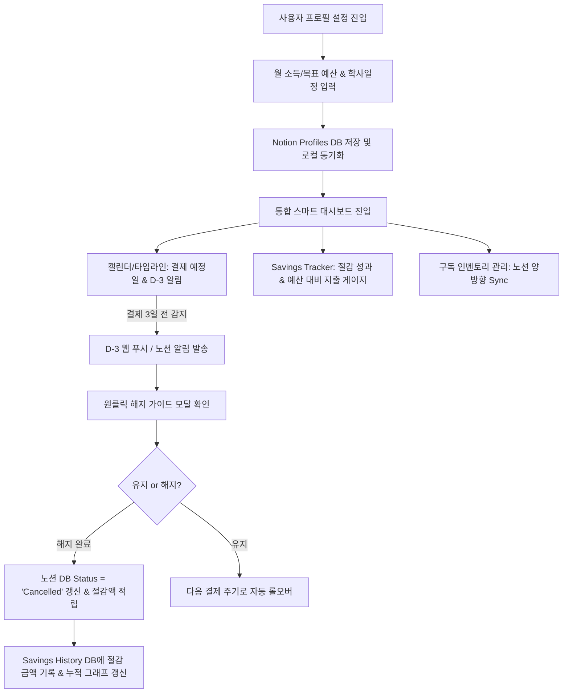
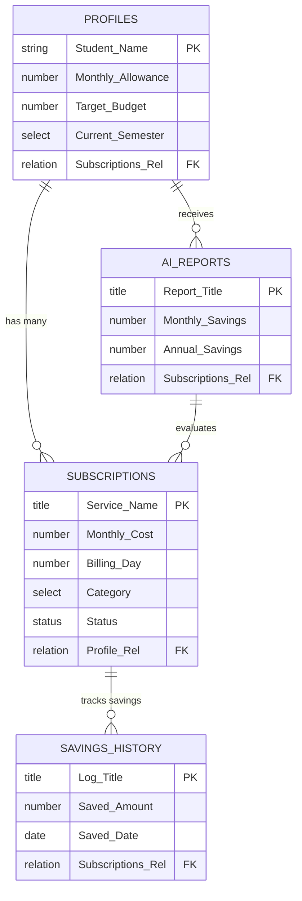

# [PRD 3단계] 대학생 프로필 구축, 노션 대시보드 연동 및 통합 관리 (Profile, Notion Sync & Savings Tracker)

---

## 1. 개요 (Overview & Objective)

### 1.1 배경 및 목적
- **배경:** 대학생의 지출 환경은 고정 수입(알바비, 부모님 용돈)의 변동성이 크고, 학사 일정(개강, 중간고사, 기말고사, 방학)에 따라 지출 우선순위가 급변한다. 1단계와 2단계에서 구독을 인식하고 최적화 리포트를 생성했더라도, 이를 지속적으로 트래킹하고 결제일을 사전에 방어하지 않으면 다시 좀비 구독 상태로 회귀하게 된다.
- **3단계 핵심 목표:**
  - 대학생 개인의 가용 소득(용돈/알바비) 및 학사 라이프사이클을 반영한 **[Student Profile]**을 구축한다.
  - 팀 노션 워크스페이스 내 **[Profiles] - [Subscriptions] - [AI Reports] - [Savings History]**의 4대 핵심 데이터베이스를 양방향 관계형(Two-way Relations & Rollup)으로 결합하여 완전한 실시간 동기화 허브를 구축한다.
  - 구독 결제 예정일 D-3 자동 알림 및 원클릭 '해지 지연 방지 가이드'를 제공한다.
  - 월별 구독 다이어트 성과를 가시화하는 **Savings Tracker (누적 절감액 & 카테고리 차트)**를 제공하여 지속 가능한 금융 습관을 형성한다.

### 1.2 핵심 성공 지표 (KPI)
- 노션 데이터베이스 실시간 CRUD 동기화 성공률: **99.5% 이상**
- D-3 결제 예정 알림 후 불필요한 자동 갱신 방어율: **40% 이상**
- 월간 목표 고정비 예산 내 지출 달성률: **80% 이상**

---

## 2. 유저 플로우 (User Flow)

---

## 3. 기능적 요구사항 (Functional Requirements & Architecture)

### 3.1 대학생 개인 프로필 설정 (Student Lifestyle Profile)
1. **수입 및 고정비 예산 설정:**
   - 월 가용 소득 입력 (알바비 + 용돈, 예: 600,000원)
   - 권장 고정비 비율 상한선 설정 (권장: 총 소득의 5~10% 이내, 예: 40,000원 설정)
2. **학사 주기 및 라이프스타일 캘린더 연동:**
   - 학기 구분: 1학기(3~6월), 여름방학(7~8월), 2학기(9~12월), 겨울방학(1~2월)
   - 시험 집중 기간 플래그 설정 (예: 4월/10월 중간고사, 6월/12월 기말고사)
   - 시험 기간 진입 시: OTT, 게임, 웹툰 등 엔터테인먼트 구독에 대해 "일시 정지(Pause) 추천 알림" 자동 트리거.
3. **핵심 관심사 카테고리 태깅:**
   - [취업/자격증], [개발/코딩], [디자인/영상], [어학/토익], [엔터테인먼트], [헬스/운동]

---

### 3.2 팀 노션 관계형 데이터베이스 구조 및 실시간 Sync 엔진

#### [노션 4대 데이터베이스 관계형 아키텍처 (ERD)]

#### [Notion API Sync 명세]
- **SDK:** `@notionhq/client` (공식 Node.js SDK)
- **동기화 파이프라인:**
  1. **초기 로드 (Read):** 대시보드 진입 시 `databases.query`를 호출하여 현재 활성 구독(Status == "Active") 목록과 프로필 예산을 병렬 Fetch.
  2. **상태 변경 (Write):** 대시보드에서 구독 삭제/해지 완료 시 `pages.update`를 통해 Notion의 `Status`를 `Cancelled`로 업데이트하고 `SAVINGS_HISTORY`에 신규 레코드 삽입.
  3. **Webhook / Cron Sync:** Vercel Cron 또는 Node.js 스케줄러를 통해 매일 자정(00:00 KST) 결제일 도래 여부 검사.

---

### 3.3 결제 예정일 D-3 알림 및 해지 지연 방지 가이드 UI/UX
1. **D-3 자동 감지 로직:**
   - 오늘 날짜(Day)와 각 구독의 `Billing Day`를 비교하여 `(Billing Day - Today == 3)`인 항목 추출 (월말 일자 28/30/31일 자동 보정).
2. **다채널 알림 스펙:**
   - 브라우저 Web Push Notification (Service Worker 기반)
   - 노션 워크스페이스 내 알림 (알림 멘션 블록 생성)
3. **해지 지연 방지 가이드 (Churn-Defrost Modal):**
   - 구독 서비스들의 복잡한 '다크 넛지(Dark Nudge, 해지 버튼 숨기기)'를 파훼하기 위한 **[30초 초간단 해지 가이드]** 제공:
     - *1단계:* 계정 설정 딥링크 바로가기 버튼 (`https://www.netflix.com/youraccount`)
     - *2단계:* 3스텝 캡처 가이드 (예: `프로필` → `계정` → `멤버십 해지` 클릭)
     - *3단계:* 해지 사유 선택 회피 팁 제공 ("기타 사유 선택 후 즉시 완료")

---

### 3.4 Savings Tracker: 월별 지출 변화 및 리밸런싱 성과 시각화
1. **지출 vs 목표 예산 트래킹 게이지 (Budget Progress):**
   - $\text{Budget Burn Rate (\%)} = \left(\frac{\text{Current Total Cost}}{\text{Target Budget}}\right) \times 100$
   - 100% 초과 시: 붉은색 경고 애니메이션 및 "목표 예산 대비 초과 지출 중입니다!" 경고.
2. **월별 누적 절감액 타임라인 차트 (Cumulative Savings Area Chart):**
   - Recharts / Chart.js 라이브러리 활용.
   - X축: 최근 6개월 (예: 2026.06 ~ 2026.11)
   - Y축: 누적 절감 금액 (KRW)
   - 툴팁: 해당 월에 해지하거나 요금제를 낮춘 서비스명 뱃지 노출.
3. **카테고리별 지출 도넛 차트 (Donut Chart):**
   - OTT, 음원, 생산성, 쇼핑 등 지출 파이 차트 제공. 중앙에 '총 고정비' 합계 노출.

---

## 4. 데이터 구조 / Notion Schema 정의

### 4.1 Notion [Profiles] DB Schema
| Property Name | Property Type | 비고 |
| :--- | :--- | :--- |
| **Student Name** | `title` | 사용자 닉네임 또는 학생 식별자 |
| **Monthly Income** | `number` | 월 용돈/알바비 (KRW) |
| **Target Fixed Budget** | `number` | 월 목표 고정비 상한선 (KRW) |
| **Academic Status** | `select` | 1학기, 여름방학, 2학기, 겨울방학, 휴학 |
| **Exam Period** | `checkbox` | 현재 시험기간 여부 (True/False) |
| **Subscriptions** | `relation` | Subscriptions DB 다대일(1:N) 릴레이션 |

### 4.2 Notion [Savings History] DB Schema
| Property Name | Property Type | 비고 |
| :--- | :--- | :--- |
| **Log Title** | `title` | 예: `2026-11 넷플릭스 해지로 절감` |
| **Saved Amount** | `number` | 절감된 금액 (월 비용 기준) |
| **Saved Date** | `date` | 절감 확정 일자 |
| **Subscription Rel** | `relation` | 해당 Subscriptions DB 레코드 연결 |

---

## 5. UI/UX 디자인 스펙

### 5.1 통합 대시보드 화면 레이아웃 (Next.js Dashboard)
- **Top Bar (학기 및 예산 인포바):**
  - "홍길동 학생의 2학기 기말고사 시즌 모드 가동 중 📚"
  - 월 목표 예산: `35,000원` / 현재 지출: `28,900원` (안전 게이지: 82% 지출)
- **Grid Left Column (지출 인벤토리 & 결제 임박 알림):**
  - **D-3 Alert Banner:** 오렌지색 펄스 효과 (`⚡ 3일 뒤 결제 예정: 쿠팡 와우 멤버십 7,890원`)
  - **Active Subscriptions List:** 카드 형태로 각 서비스의 로고, 금액, 결제일, 노션 실시간 동기화 상태 표시.
- **Grid Right Column (Savings Tracker & 인사이트):**
  - **누적 세이빙 지표:** 큰 폰트의 볼드 텍스트 (`🎉 총 148,200원 방어 완료`)
  - **Area Chart:** 지속적으로 우상향하는 누적 절감액 그래프.
  - **도넛 차트:** 카테고리별 비중 시각화.
- **Floating Action Button:**
  - `[+ 새 구독 추가 (1단계로 이동)]`
  - `[🔄 노션 실시간 동기화 새로고침]`

---

## 6. 예외 처리 및 에러 핸들링 (Exception Handling)

| 상황 (Scenario) | 에러 코드 | 대응 정책 (Fallback Strategy) |
| :--- | :--- | :--- |
| **Notion API Rate Limit (3 req/sec 초과)** | `NOTION_429_RATE_LIMIT` | 지수 백오프(Exponential Backoff)를 적용하고, 요청 대기 큐(Request Queue)를 두어 순차 동기화. |
| **브라우저 알림 권한 거부** | `PUSH_PERMISSION_DENIED` | 브라우저 인앱 토스트 팝업 및 노션 페이지 내 '결제 임박' 리마인더 블록 생성으로 채널 전환. |
| **목표 예산 대비 150% 이상 초과 지출** | `WARN_BUDGET_OVERFLOW` | 대시보드 전면에 '비상 리밸런싱 경고' 모달을 띄우고 즉시 2단계 해지 추천 Top 3 실행을 권고. |
| **네트워크 단절 / 오프라인 상태** | `OFFLINE_SYNC_PENDING` | LocalStorage / IndexedDB에 상태 변경 사항을 임시 적재 후 네트워크 재연결 시 노션으로 일괄 동기화(Bulk Sync). |

---

## 7. 개발 체크리스트 (Definition of Done)
- [ ] 대학생 프로필 설정 페이지(용돈, 목표 고정비, 학사 일정) 구현
- [ ] 팀 노션 4대 DB(Profiles, Subscriptions, AI Reports, Savings History) 양방향 관계형 설정 완료
- [ ] 결제 D-3 알림 스케줄러(자정 검사 Cron) 및 브라우저 푸시 모듈 개발
- [ ] 주요 구독 서비스 5종(넷플릭스, 유튜브, 쿠팡, 티빙, 챗GPT) 원클릭 해지 가이드 모달 제작
- [ ] Recharts 기반 누적 절감액(Area Chart) 및 카테고리별 지출(Donut Chart) 연동 완료
- [ ] 전체 1단계~3단계 E2E(End-to-End) 유저 시나리오 검증 및 테스트 완료
